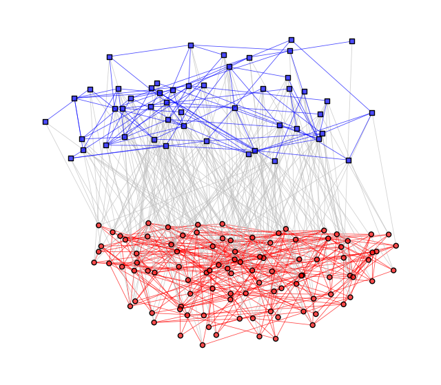

# multinets: Multilevel Network Analysis

[](https://www.gnu.org/licenses/gpl-3.0.en.html)

`multinets` is a Python package that provides tools to visualize and analyze
multilevel network data, as described in Lazega et al. (2008)
[doi:10.1016/j.socnet.2008.02.001](https://doi.org/10.1016/j.socnet.2008.02.001)
and in Lazega and Snijders (2016, ISBN:978-3-319-24520-1). It was built as an
extension to [`igraph`](https://python.igraph.org) and also works with
[`networkx`](https://networkx.org) graphs.

It is the Python version of the
[`multinets` R package](https://github.com/neylsoncrepalde/multinets), with the
same features.

**Documentation:** <https://neylsoncrepalde.github.io/multinets-py/>.

## Installation

```bash
pip install multinets              # igraph backend
pip install "multinets[networkx]"  # + networkx support
pip install "multinets[plot]"      # + matplotlib, to plot with igraph.plot()
```

To install the development version from a local clone:

```bash
pip install -e ".[test]"
```

## Usage

As a basic example, we will plot a multilevel network. We are going to use
`linked_sim`, a simulated multilevel network dataset.

```python
import igraph as ig
import matplotlib.pyplot as plt
from multinets import (
    is_multilevel,
    layout_multilevel,
    load_linked_sim,
    set_color_multilevel,
    set_shape_multilevel,
)

# Load the dataset
linked_sim = load_linked_sim()

# Test if the data is a multilevel network
is_multilevel(linked_sim)
#> True

# Set the layout coordinates
l = layout_multilevel(linked_sim, layout="kk")

# Set different colors and shapes for each level vertices
linked_sim = set_color_multilevel(linked_sim)
linked_sim = set_shape_multilevel(linked_sim)

# Plot
fig, ax = plt.subplots(figsize=(8, 7))
ig.plot(linked_sim, target=ax, layout=l, vertex_size=7, edge_width=0.6)
```



Each level can be analyzed on its own:

```python
from multinets import extract_highlevel, extract_lowlevel, extract_mesolevel, mode_transformation

organizations = extract_highlevel(linked_sim)  # 1-mode: higher level vertices and their ties
individuals = extract_lowlevel(linked_sim)     # 1-mode: lower level vertices and their ties
affiliations = extract_mesolevel(linked_sim)   # 2-mode: only ties across levels

# Project the affiliation network onto each level
transformed = mode_transformation(affiliations)
transformed.low, transformed.high
high_transformed = mode_transformation(affiliations, which="high")
```

### Levels

A multilevel network is a bipartite (2-mode) network that also has ties between
vertices within each level. As in igraph, the level of each vertex is a boolean
vertex attribute, `type` by default: `True` for the higher level (usually
organizations), `False` for the lower level (usually individuals). Every
function takes a `type_attr` argument to use another attribute.

### networkx

Every function also accepts networkx graphs and returns networkx objects:
graphs of the same class, and `{node: coordinates}` dicts from
`layout_multilevel()`. networkx's own bipartite convention is a `bipartite`
node attribute:

```python
import networkx as nx
from multinets import layout_multilevel, set_color_multilevel

G = nx.Graph()
G.add_nodes_from(["ana", "bruno", "carla"], bipartite=False)  # individuals
G.add_nodes_from(["firm1", "firm2"], bipartite=True)           # organizations
G.add_edges_from([("ana", "bruno"), ("bruno", "carla"), ("firm1", "firm2"),
                  ("ana", "firm1"), ("bruno", "firm1"), ("carla", "firm2")])

pos = layout_multilevel(G, layout=nx.spring_layout, type_attr="bipartite", seed=1)
G = set_color_multilevel(G, type_attr="bipartite")
nx.draw(G, pos,
        node_color=[c for _, c in G.nodes(data="color")],
        edge_color=[c for *_, c in G.edges(data="color")])
```

## Differences from the R package

* **Stricter `is_multilevel()`.** It checks that there are ties across levels
  and ties within *both* levels (self-loops don't count). The R version only
  looks for ties within the lower level.
* **No in-place changes by default.** `set_color_multilevel()` and
  `set_shape_multilevel()` return a modified copy, like R. Pass
  `inplace=True` to modify the graph itself (the function then returns `None`).
* **`mode_transformation(which="both")`** returns a `Projections(low, high)`
  named tuple instead of `list(proj1, proj2)`.
* **Layouts** accept an igraph layout name (`"fr"`, `"kk"`, ...) or a callable,
  and extra keyword arguments are passed on to it. Vertices whose y coordinate
  is exactly 0 are placed on their level, and 3D layouts keep their z
  coordinate.
* **Layout coordinates don't match R numerically**, even with a seed: python-igraph
  uses Python's `random` module (`random.seed()` makes layouts reproducible).
* **Errors** are `TypeError` (not a graph) and `ValueError` (not bipartite, not
  multilevel), with the same messages as in R.
* **Datasets** are functions: `load_linked_sim()`, `load_linked_sim_matrix()`
  and `load_linked_sim_type()`.
* No startup message.

## Development

```bash
python -m venv .venv && .venv/bin/pip install -e ".[test]"
.venv/bin/python -m pytest
```

To build the documentation into `docs/_build/html`:

```bash
.venv/bin/pip install -e ".[docs]"
.venv/bin/sphinx-build -W --keep-going -d docs/_build/doctrees docs docs/_build/html
```

`src/multinets/data/linked_sim.graphml` is exported from the R package data by
`scripts/export_linked_sim.R`, and `docs/figures/readme-example.png` is made by
`scripts/readme_figure.py`.
